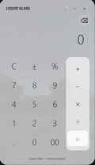
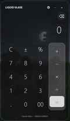

# Liquid Glass Calculator

A desktop calculator for Windows, built with Python and PySide6, featuring a translucent "Liquid Glass" interface.

## Screenshots

| Light theme | Dark theme |
| --- | --- |
|  |  |

## Features

- Dark and light themes
- Frameless, draggable window
- Keyboard input (digits, arithmetic operators, Enter, Backspace, Delete and Escape)
- Repeated calculation when pressing `=` again
- Basic arithmetic, percentages, sign toggle and decimal input

## Run from source

1. Install Python 3.10 or later.
2. Install dependencies:

   ```bash
   python -m pip install -r requirements.txt
   ```

3. Start the calculator:

   ```bash
   python calculator.py
   ```

## Windows executable

Download **LiquidGlassCalculator.exe** from the [latest GitHub Release](https://github.com/gamonret/LiquidGlassCalculator/releases/latest).

## Build your own EXE

```bash
python -m pip install pyinstaller
python -m PyInstaller --noconfirm --clean --onefile --windowed --name LiquidGlassCalculator calculator.py
```
